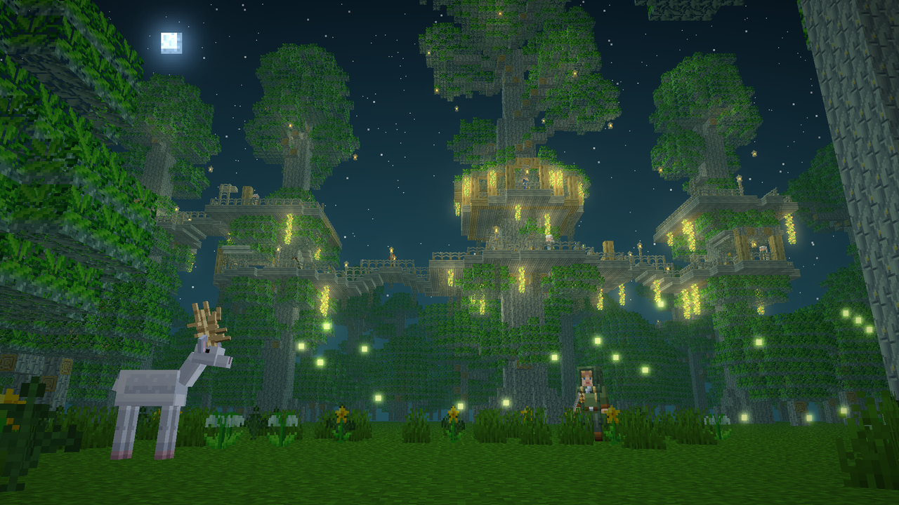

# Lothlórien for Minecraft Bedrock

A rare, peaceful Lothlórien biome for Minecraft Bedrock Edition: golden Mallorn trees reaching into the sky, elven villages in their crowns, gentle wildlife, and elves who remember how you treat their forest. It is a behavior pack plus a resource pack and needs no experimental toggles.

> **Status: pre-release 0.8.0, private testing.** Things may still change a lot.

## Features

- **The biome:** a Lothlórien forest with golden light, its own sky and fog, and plentiful flora: Elanor, Niphredil, Athelas, Golden Fern, Nectar Bloom, western corn and more.
- **Mallorn trees:** a full Mallorn wood set (logs, planks, stairs, slabs, doors, trapdoors, fences, gates, buttons, pressure plates, boats, chest boats), golden leaves, acorns and Great Mallorn nuts.
- **Elven villages:** settlements built in and around giant Mallorn trees, with platforms, bridges, homes and a central tree. Lanterns, chandeliers and rope are added for building.
- **Elves:** villagers with professions and trades, and the Loremaster, a teacher who sets lessons and requests.
- **Elven Wardens:** archers who watch over the forest and its people.
- **Harmony and Renown:** Harmony measures how peacefully you behave in the forest; Renown is earned with the elves and unlocks trades and gifts.
- **Wildlife:** deer, the rare white deer, swans, songbirds, ground squirrels, butterflies, fireflies and the unicorn. Some give venison, swan meat or antlers; fireflies can be caught in bottles.
- **Woodland places:** root shrines, flower gardens and leaf memorials found in the wild.
- **Sindarin voice:** elves and wardens speak short Sindarin phrases.
- **Soundscape:** harp music in elven villages, and sounds at shrines and memorials.
- **Items:** the Bow of the Galadhrim and its arrows, the Phial of Galadriel, lembas, Miruvor, Athelas salve, elven cloak and silver belt, firefly jars and more.

## Install

1. Download the latest `.mcaddon` from the [Releases page](../../releases) (pre-releases are listed there).
2. Open the file with Minecraft; it imports both packs. The resource pack comes with it.
3. Create a world and enable the Lothlórien **behavior pack** (the resource pack is attached to it).

Requirements: Minecraft Bedrock Edition 1.26.50 or newer. No experimental features need to be switched on.

## Warning: new chunks only

The biome and its structures appear only in **newly generated chunks**. Use a new world, or back up your world before adding the pack to an existing one.

## Known issues

- Mallorn and golden leaves can flicker at some angles (z-fighting between leaf faces). The known fixes looked worse.
- Where independent worldgen starts overlap, a build can be cut off. The engine offers no better option.
- Some vanilla features are left out because Bedrock does not allow them for custom content: see [docs/NOT_IMPLEMENTED.md](docs/NOT_IMPLEMENTED.md) and the vanilla-parity limits in [docs/parity/BLOCKS_ITEMS.md](docs/parity/BLOCKS_ITEMS.md).

## Feedback

Please report bugs and ideas as [GitHub issues](../../issues). Note your Minecraft version, device, and whether the world was new.

## Credits

Made by Teliendan (karel-murgas).

- Textures, models and key art are made with scripts written for this project.
- The **music**, the **shrine and memorial sounds** and the **Sindarin voice lines** are AI-generated with locally run models and then edited. The voice lines speak phrases checked against published Sindarin sources.
- Sindarin words and phrases rest on Tolkien's published works as compiled in [Eldamo: An Elvish Lexicon](https://eldamo.org) by Paul Strack. Some phrases are Neo-Sindarin constructions, not Tolkien's own.
- The forest rustles in the biome are Minecraft's own vanilla sounds.

## Disclaimer

This is unofficial fan work inspired by J.R.R. Tolkien's legendarium. It is not affiliated with or endorsed by the Tolkien Estate, Middle-earth Enterprises, Mojang Studios or Microsoft. "Minecraft" is a trademark of Mojang Studios / Microsoft. Tolkien's names and works belong to their owners, and the licence grants no rights to them. Anything derived from vanilla Minecraft files remains Mojang's.

## Licence

See [LICENSE.md](LICENSE.md).

## For developers

- `lothlorien_bp/` is the behavior pack (JSON plus Script API in `scripts/`); `lothlorien_rp/` is the resource pack. Namespace: `lothlorien:`.
- `tools/` holds generators for art, audio and structures; `tests/` holds the regression tests.
- Design, decisions and limits are indexed in [docs/README.md](docs/README.md); what is left to do is in [docs/TODO.md](docs/TODO.md).
- Building, verifying and packaging use a separate workspace tool that is not part of this repository.
